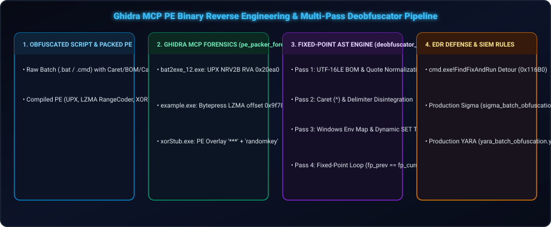
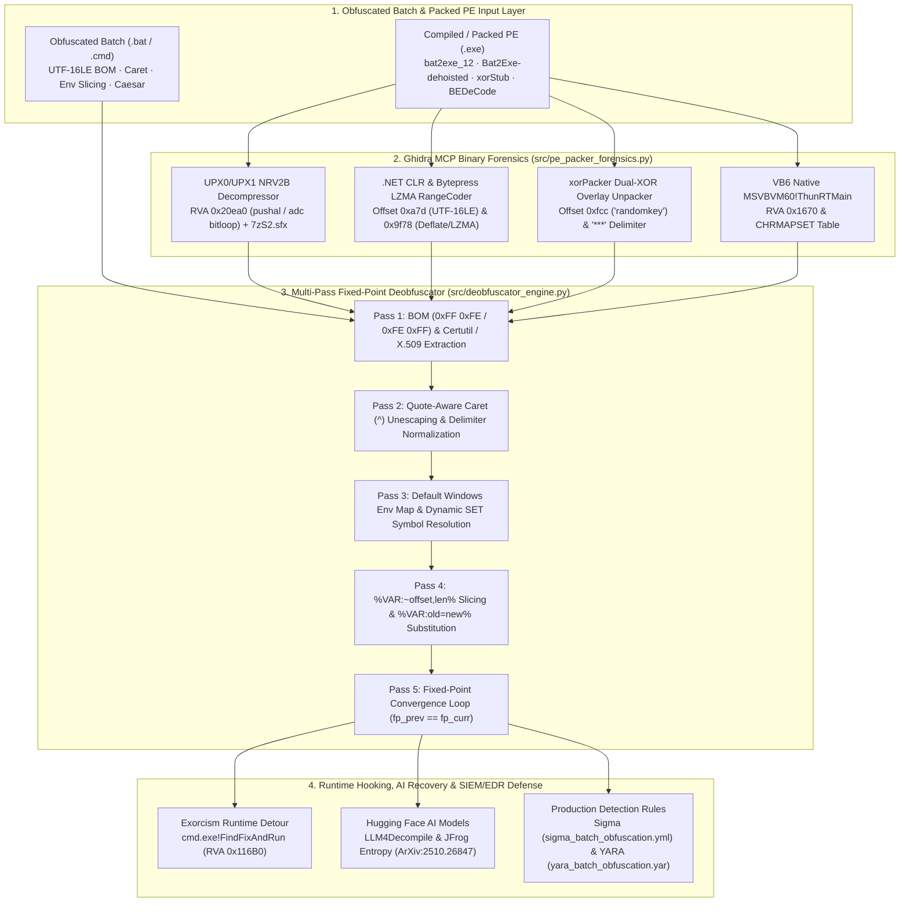

<div align="center">

<p align="center">
  <strong>🇺🇸 English</strong> · <a href="./docs/locales/ko.md">🇰🇷 한국어</a> · <a href="./docs/locales/zh-CN.md">🇨🇳 中文</a> · <a href="./docs/locales/es.md">🇪🇸 Español</a> · <a href="./docs/locales/hi.md">🇮🇳 हिन्दी</a><br />
  <a href="./docs/locales/ar.md">🇸🇦 العربية</a> · <a href="./docs/locales/pt-BR.md">🇧🇷 Português</a> · <a href="./docs/locales/ru.md">🇷🇺 Русский</a> · <a href="./docs/locales/fr.md">🇫🇷 Français</a> · <a href="./docs/locales/id.md">🇮🇩 Bahasa Indonesia</a>
</p>

<p align="center">
  <a href="https://github.com/maya-thorne/batch-deobfuscator-re"></a>
</p>

# 🔬 batch-deobfuscator-re

**Multi-Pass Batch Deobfuscator Engine, Ghidra PE Unpacker Forensics & Reference Archive**

[](./docs/whitepapers/GHIDRA_BINARY_RE_AND_DEOBFUSCATOR_ENGINE_ANALYSIS.md)
[](./src/deobfuscator_engine.py)
[](./src/pe_packer_forensics.py)
[](./rules/)
[](https://github.com/maya-thorne/batch-deobfuscator-re/releases)
[](./LICENSE)

<sub>Engineered &amp; Audited by **[Maya Thorne](https://github.com/maya-thorne)** · Low-Level Systems &amp; Reverse Engineering Research</sub>

</div>

---

<!-- Quick Jump Navigation Bar -->
<div align="center">

<p align="center">
  <a href="#1-architecture--reverse-engineering-pipeline"><b>🏛️ Architecture</b></a> &nbsp;•&nbsp;
  <a href="#2-master-whitepapers--core-documentation-index"><b>📚 Whitepapers</b></a> &nbsp;•&nbsp;
  <a href="#3-ghidra-mcp-binary-reverse-engineering-summary-7-pe-binaries"><b>🔍 Ghidra RE</b></a> &nbsp;•&nbsp;
  <a href="#4-quickstart-cli-toolchain--deobfuscator-engine"><b>🛠️ Quickstart</b></a> &nbsp;•&nbsp;
  <a href="#5-repository-directory-structure"><b>📂 Structure</b></a> &nbsp;•&nbsp;
  <a href="#6-license--open-source-research-credits"><b>📜 License &amp; Credits</b></a>
</p>

</div>

---

<span id="1-architecture--reverse-engineering-pipeline"></span>
<details open id="architecture-pipeline">
<summary><h2 style="display:inline-block; margin:0;">🏛️ 1. Architecture &amp; Reverse Engineering Pipeline</h2></summary>

<br />

`batch-deobfuscator-re` combines **Ghidra MCP (`ghidra-re-operator`) binary reverse engineering** of Windows Batch-to-EXE compilers/packers, **line-by-line source code dissection of 7 flagship obfuscation/deobfuscation engines**, a **custom Python Multi-Pass Fixed-Point Static Deobfuscator (`src/deobfuscator_engine.py`)**, a **Static PE Packer Forensic Unpacker (`src/pe_packer_forensics.py`)**, and **48+ flattened open-source &amp; Hugging Face AI references**.

<p align="center">
  <a href="https://github.com/maya-thorne/batch-deobfuscator-re"></a>
</p>



</details>

---

<span id="2-master-whitepapers--core-documentation-index"></span>
<details open id="master-whitepapers">
<summary><h2 style="display:inline-block; margin:0;">📚 2. Master Whitepapers &amp; Core Documentation Index</h2></summary>

<br />

<table width="100%">
  <thead>
    <tr>
      <th width="22%" align="left"><nobr>📄 Document / Whitepaper</nobr></th>
      <th width="68%" align="left"><nobr>🔬 Scope &amp; Technical Highlights</nobr></th>
      <th width="10%" align="center"><nobr>📦 Size</nobr></th>
    </tr>
  </thead>
  <tbody>
    <tr>
      <td>
        🔬 <strong><a href="./docs/whitepapers/GHIDRA_BINARY_RE_AND_DEOBFUSCATOR_ENGINE_ANALYSIS.md">Binary RE &amp; Engine Analysis</a></strong><br>
        <code>GHIDRA_<wbr>BINARY_<wbr>RE_<wbr>AND_<wbr>DEOBFUSCATOR_<wbr>ENGINE_<wbr>ANALYSIS.md</code>
      </td>
      <td>
        <strong>Ghidra MCP 7-Binary Disassembly &amp; 7-Tool Source Dissection</strong>: <code>bat2exe_12.exe</code> (<code>0x20ea0</code> UPX NRV2B), <code>example_bytepressed.exe</code> (<code>0x9f78</code> LZMA RangeCoder), <code>xorStub.exe</code> (<code>0xfcc "randomkey"</code>), <code>BEDeCode.exe</code> (<code>0x1670</code> VB6 <code>ThunRTMain</code>), plus <code>Invoke-DOSfuscation</code>, <code>SomalifuscatorV2</code>, <code>BatCloak</code>, <code>Exorcism</code>, <code>0xidiz3r</code>, <code>Bat2Exe-dehoisted</code>, <code>batch_deobfuscator</code>.
      </td>
      <td align="center"><strong>44.4 KB</strong></td>
    </tr>
    <tr>
      <td>
        📖 <strong><a href="./docs/whitepapers/BATCH_OBFUSCATION_MASTER_GUIDE.md">30-Year Evolution &amp; Architecture</a></strong><br>
        <code>BATCH_<wbr>OBFUSCATION_<wbr>MASTER_<wbr>GUIDE.md</code>
      </td>
      <td>
        <strong>30-Year Evolution &amp; Architecture Guide</strong>: 1990s MS-DOS to 2026 AI, <code>cmd.exe</code> 5-stage parser state machine, 12 obfuscation techniques, 4-Tier 45-repo matrix, Sigma/YARA rules.
      </td>
      <td align="center"><strong>33.6 KB</strong></td>
    </tr>
    <tr>
      <td>
        🛡️ <strong><a href="./docs/whitepapers/BATCH_OBFUSCATION_ENCYCLOPEDIA.md">Master Encyclopedia (v2.0)</a></strong><br>
        <code>BATCH_<wbr>OBFUSCATION_<wbr>ENCYCLOPEDIA.md</code>
      </td>
      <td>
        <strong>Comprehensive Encyclopedia (v2.0)</strong>: 48 repositories taxonomy, AST pushdown automata, Hugging Face dataset integration.
      </td>
      <td align="center"><strong>30.3 KB</strong></td>
    </tr>
    <tr>
      <td>
        🧬 <strong><a href="./docs/whitepapers/DEEP_REVERSE_ENGINEERING_AND_SOURCE_ANALYSIS.md">Deep Binary &amp; Source Analysis</a></strong><br>
        <code>DEEP_<wbr>REVERSE_<wbr>ENGINEERING_<wbr>AND_<wbr>SOURCE_<wbr>ANALYSIS.md</code>
      </td>
      <td>
        <strong>Extended Binary &amp; Source Analysis</strong>: Supplemental PE header forensics, <code>choice.exe</code> MSVC SEH frame (<code>fs:[0]</code>), and runtime hook tables.
      </td>
      <td align="center"><strong>42.8 KB</strong></td>
    </tr>
    <tr>
      <td>
        🏛️ <strong><a href="./docs/whitepapers/BATCH_OBFUSCATION_ARCHITECTURE_AND_CODE_ANALYSIS.md">Architecture &amp; Source Dissection</a></strong><br>
        <code>BATCH_<wbr>OBFUSCATION_<wbr>ARCHITECTURE_<wbr>AND_<wbr>CODE_<wbr>ANALYSIS.md</code>
      </td>
      <td>
        <strong>Line-by-Line Source Dissection</strong>: In-depth code teardown of 7 flagship tools (<code>Invoke-DOSfuscation</code>, <code>SomalifuscatorV2</code>, <code>BatCloak</code>, <code>Exorcism</code>, etc.) and AST transformation pipelines.
      </td>
      <td align="center"><strong>43.7 KB</strong></td>
    </tr>
    <tr>
      <td>
        🛡️ <strong><a href="./docs/whitepapers/BATCLOAK_SCRUBCRYPT_DEEP_DIVE.md">BatCloak &amp; ScrubCrypt Deep Dive</a></strong><br>
        <code>BATCLOAK_<wbr>SCRUBCRYPT_<wbr>DEEP_<wbr>DIVE.md</code>
      </td>
      <td>
        <strong>Modern 2023–2026 EDR Evasion</strong>: Multi-stage loader architecture, AMSI bypass vectors, and EDR process injection mitigation forensics.
      </td>
      <td align="center"><strong>2.9 KB</strong></td>
    </tr>
    <tr>
      <td>
        🤗 <strong><a href="./docs/whitepapers/HUGGINGFACE_MODELS_AND_DATASETS.md">AI Models &amp; Datasets</a></strong><br>
        <code>HUGGINGFACE_<wbr>MODELS_<wbr>AND_<wbr>DATASETS.md</code>
      </td>
      <td>
        <strong>AI Deobfuscation &amp; Entropy Research</strong>: <code>LLM4Decompile-SFT-Deobfuscate</code>, <code>c-deobfuscate-mt</code> (T5), JFrog Token Entropy (ArXiv:2510.26847), EDR Telemetry.
      </td>
      <td align="center"><strong>5.1 KB</strong></td>
    </tr>
    <tr>
      <td>
        🕵️ <strong><a href="./docs/whitepapers/RESEARCH_WHITEPAPERS_AND_REPORTS.md">Threat Intelligence Reports</a></strong><br>
        <code>RESEARCH_<wbr>WHITEPAPERS_<wbr>AND_<wbr>REPORTS.md</code>
      </td>
      <td>
        <strong>Global Threat Intelligence Breakdown</strong>: Mandiant (Daniel Bohannon <code>DOSfuscation</code> / <code>FIN7</code>) &amp; Palo Alto Unit 42 (<code>BatCloak</code> / <code>ScrubCrypt</code>).
      </td>
      <td align="center"><strong>5.5 KB</strong></td>
    </tr>
    <tr>
      <td>
        📜 <strong><a href="./docs/whitepapers/CLASSIC_TO_MODERN_EVOLUTION.md">Classic to Modern Evolution</a></strong><br>
        <code>CLASSIC_<wbr>TO_<wbr>MODERN_<wbr>EVOLUTION.md</code>
      </td>
      <td>
        <strong>Historical Evolution &amp; PoC Analysis</strong>: Generation 1–5 batch obfuscation paradigms &amp; <code>BatCloak</code>/<code>ScrubCrypt</code> 3-stage loader forensics.
      </td>
      <td align="center"><strong>7.2 KB</strong></td>
    </tr>
  </tbody>
</table>

</details>

---

<span id="3-ghidra-mcp-binary-reverse-engineering-summary-7-pe-binaries"></span>
<details open id="ghidra-re-summary">
<summary><h2 style="display:inline-block; margin:0;">🔍 3. Ghidra MCP Binary Reverse Engineering Summary (7 PE Binaries)</h2></summary>

<br />

<table width="100%">
  <thead>
    <tr>
      <th width="22%" align="left"><nobr>🎯 Target Binary</nobr></th>
      <th width="18%" align="left"><nobr>🏗️ Compiler / Packer</nobr></th>
      <th width="16%" align="center"><nobr>📍 Entry RVA / Offset</nobr></th>
      <th width="44%" align="left"><nobr>🔬 Disassembled Mechanism &amp; Forensic Finding</nobr></th>
    </tr>
  </thead>
  <tbody>
    <tr>
      <td>
        <strong><code>bat2exe_<wbr>12.exe</code></strong><br>
        <small>(<code>bat2exe-islamadel</code>)</small>
      </td>
      <td>Native C++<br><sub>UPX NRV2B + <code>7zS2.sfx</code></sub></td>
      <td align="center"><code>0x20ea0</code><br><sub>(File <code>0xd2a0</code>)</sub></td>
      <td>
        <code>UPX0</code> (RVA <code>0x1000</code>, raw <code>0B</code>) + <code>UPX1</code> (RVA <code>0x14000</code>, raw <code>56,832B</code>). <code>pushal</code> saves registers, <code>lea edi, [esi-0x13000]</code> targets <code>UPX0</code>, and <code>add ebx, ebx</code> / <code>adc eax, eax</code> unpacks NRV2B bitstream; <code>bat2exe.cmd</code> merges <code>7zS2.sfx + config.txt + 7z</code> via <code>copy /b</code>.
      </td>
    </tr>
    <tr>
      <td>
        <strong><code>BEDeCode.exe</code></strong><br>
        <small>(<code>Batch-Encryption-DeCoder</code>)</small>
      </td>
      <td>VB6 Native Code<br><sub>(<code>MSVBVM60.DLL</code>)</sub></td>
      <td align="center"><code>0x1670</code><br><sub>(File <code>0x1670</code>)</sub></td>
      <td>
        <code>PUSH 0x401968 (VBHeader)</code> ➔ <code>CALL 0x0040166a (JMP [0x004010a0] ThunRTMain)</code>.<br>
        Contains <code>CHRMAPSET</code> substitution table at <code>0x32c8 (w54s8a7d6f9j3k2l...)</code> to invert <code>0xFF 0xFE 0x0D 0x0A cls</code> header cipher.
      </td>
    </tr>
    <tr>
      <td>
        <strong><code>example.exe</code></strong><br>
        <small>(<code>Bat2Exe-dehoisted</code>)</small>
      </td>
      <td>C# .NET CLR<br><sub>(<code>AnyCPU</code>)</sub></td>
      <td align="center"><code>0x2050</code><br><sub>(Offset <code>0xa7d</code>)</sub></td>
      <td>
        Uncompressed <code>.text</code> section exposes UTF-16LE batch script (<code>@echo off...</code>) in <code>.NET #US</code> (User Strings) heap at <code>0xa7d</code>, passed directly to <code>Process.Start("cmd.exe", "/c ...")</code>.
      </td>
    </tr>
    <tr>
      <td>
        <strong><code>example_<wbr>encoded.exe</code></strong><br>
        <small>(<code>Bat2Exe-dehoisted</code>)</small>
      </td>
      <td>C# .NET CLR<br><sub>(Base64 Wrapper)</sub></td>
      <td align="center">Offset <code>0xa7d</code><br><sub>(<code>#US</code> Heap)</sub></td>
      <td>
        Wraps batch payload in <code>Convert.FromBase64String(...)</code> inside <code>CMethods.ExecuteCommand</code>, still statically recoverable from <code>#US</code> stream.
      </td>
    </tr>
    <tr>
      <td>
        <strong><code>example_<wbr>bytepressed.exe</code></strong><br>
        <small>(<code>Bat2Exe-dehoisted</code>)</small>
      </td>
      <td>C# .NET CLR<br><sub>(Bytepress LZMA)</sub></td>
      <td align="center">Offset <code>0x9f78</code><br><sub>(<code>RangeCoder</code>)</sub></td>
      <td>
        Embeds <code>bytepress.lib.LZMA.Compress.RangeCoder</code> (<code>BitTreeEncoder</code>, <code>LzBinTree</code>) and decompresses resource stream in-memory into <code>Assembly.Load(byte[])</code>.
      </td>
    </tr>
    <tr>
      <td>
        <strong><code>xorStub.exe</code></strong><br>
        <small>(<code>xorPacker-master</code>)</small>
      </td>
      <td>MSVC Native C++<br><sub>(PE Overlay)</sub></td>
      <td align="center"><code>0x2dcc</code><br><sub>(File <code>0xfcc</code>)</sub></td>
      <td>
        Hardcodes 9-byte master key <code>"randomkey"</code> at <code>0xfcc</code>. Splits EOF overlay by <code>"***" (0x2A 0x2A 0x2A)</code>, decrypts dynamic key via <code>XOR(part[2], "randomkey")</code>, then decrypts payload via <code>XOR(part[1], dyn_key)</code> into <code>%TEMP%\temp.exe</code>.
      </td>
    </tr>
    <tr>
      <td>
        <strong><code>choice.exe</code></strong><br>
        <small>(<code>bat2exe-islamadel</code>)</small>
      </td>
      <td>MSVC Native C<br><sub>(<code>MSVCRT.dll</code>)</sub></td>
      <td align="center"><code>0x1491</code><br><sub>(CRT Startup)</sub></td>
      <td>
        Sets up x86 SEH frame (<code>mov eax, fs:[0]</code>, <code>push 0x4015c0 __except_handler3</code>), parses single-keystroke timeout for legacy batch menus.
      </td>
    </tr>
  </tbody>
</table>

</details>

---

<span id="4-quickstart-cli-toolchain--deobfuscator-engine"></span>
<details open id="quickstart-cli">
<summary><h2 style="display:inline-block; margin:0;">🛠️ 4. Quickstart: CLI Toolchain &amp; Deobfuscator Engine</h2></summary>

<br />

<p align="center">
  <a href="https://github.com/maya-thorne/batch-deobfuscator-re"></a>
</p>

### 4.1 Production CLI Usage (`batch-deobfuscator` / `python -m deobfuscator`)
```bash
# 1. Install locally via PEP 517/621
pip install .

# 2. One-click deobfuscation to stdout or clean output file
batch-deobfuscator samples/01_env_slicing_sample.bat
batch-deobfuscator samples/02_caret_and_delimiters_sample.bat -o clean.bat

# 3. View terminal colorized Before & After syntax diff
batch-deobfuscator samples/02_caret_and_delimiters_sample.bat --diff

# 4. Export forensic telemetry & resolved symbol table in JSON format
batch-deobfuscator samples/03_dynamic_substitution_table_sample.bat --format json

# 5. Export Canadian Centre for Cyber Security (CCCS) Assemblyline 4 Service Result JSON
batch-deobfuscator samples/03_dynamic_substitution_table_sample.bat --format assemblyline
batch-deobfuscator samples/03_dynamic_substitution_table_sample.bat --assemblyline-out report.json

# 6. Launch interactive cyber-forensic web dashboard & real-time entropy heatmap
batch-deobfuscator --web
batch-deobfuscator --web --port 8080 --host 127.0.0.1
batch-deobfuscator samples/01_env_slicing_sample.bat --web

# 7. Direct Python module execution (zero installation required)
python -m deobfuscator samples/01_env_slicing_sample.bat --verbose
```

### 4.2 CLI Options &amp; Flags Reference

<table width="100%">
  <thead>
    <tr>
      <th width="22%" align="left"><nobr>⚙️ Flag / Option</nobr></th>
      <th width="63%" align="left"><nobr>📝 Description &amp; Forensic Behavior</nobr></th>
      <th width="15%" align="center"><nobr>⚙️ Default</nobr></th>
    </tr>
  </thead>
  <tbody>
    <tr>
      <td><code>&lt;input&gt;</code></td>
      <td>Obfuscated <code>.bat</code> or <code>.cmd</code> script path to be deobfuscated</td>
      <td align="center"><em>Required</em></td>
    </tr>
    <tr>
      <td><code>-o, --output</code></td>
      <td>Destination path for cleaned output script (omitting writes to stdout)</td>
      <td align="center"><code>stdout</code></td>
    </tr>
    <tr>
      <td><code>-p, --passes</code></td>
      <td>Maximum fixed-point AST convergence passes (terminates early upon convergence)</td>
      <td align="center"><code>15</code></td>
    </tr>
    <tr>
      <td><code>-d, --diff</code></td>
      <td>Render ANSI terminal colorized unified diff highlighting transformed lines</td>
      <td align="center"><code>False</code></td>
    </tr>
    <tr>
      <td><code>--format</code></td>
      <td>Output format: <code>text</code> for clean script only, <code>json</code> for telemetry &amp; symbols, or <code>assemblyline</code> for CCCS Assemblyline 4 Service Result JSON</td>
      <td align="center"><code>text</code></td>
    </tr>
    <tr>
      <td><code>--assemblyline-out</code></td>
      <td>Destination path to export CCCS Assemblyline 4 Service Result JSON report and extracted stagers</td>
      <td align="center"><code>None</code></td>
    </tr>
    <tr>
      <td><code>--web, --dashboard</code></td>
      <td>Launch interactive browser-based cyber-forensics dashboard &amp; real-time entropy heatmap visualizer</td>
      <td align="center"><code>False</code></td>
    </tr>
    <tr>
      <td><code>--port</code></td>
      <td>Server port for the web dashboard HTTP service</td>
      <td align="center"><code>8080</code></td>
    </tr>
    <tr>
      <td><code>--host</code></td>
      <td>Server bind address for the web dashboard (local loopback default)</td>
      <td align="center"><code>127.0.0.1</code></td>
    </tr>
    <tr>
      <td><code>--no-browser</code></td>
      <td>Do not automatically open the default web browser when starting the dashboard</td>
      <td align="center"><code>False</code></td>
    </tr>
    <tr>
      <td><code>--no-batcloak</code></td>
      <td>Disable BatCloak <code>%RANDOM%</code> and junk variable preprocessing</td>
      <td align="center"><code>False</code></td>
    </tr>
    <tr>
      <td><code>--no-somalifuscator</code></td>
      <td>Disable Somalifuscator Caesar cipher inversion and KDOT array resolution</td>
      <td align="center"><code>False</code></td>
    </tr>
    <tr>
      <td><code>--no-oxidizer</code></td>
      <td>Disable 0xidiz3r zero-literal bootstrap resolution and alphabet normalization</td>
      <td align="center"><code>False</code></td>
    </tr>
    <tr>
      <td><code>--no-abobus</code></td>
      <td>Disable Abobus Unicode noise filtering, decoy elimination, and trap chaff removal</td>
      <td align="center"><code>False</code></td>
    </tr>
    <tr>
      <td><code>--no-dosfuscation</code></td>
      <td>Disable Invoke-DOSfuscation Bohannon loop unwrapping and advanced slicing</td>
      <td align="center"><code>False</code></td>
    </tr>
    <tr>
      <td><code>--no-cradlecrafter</code></td>
      <td>Disable Invoke-CradleCrafter and PowerShell download stager deobfuscation</td>
      <td align="center"><code>False</code></td>
    </tr>
    <tr>
      <td><code>--no-bedecode</code></td>
      <td>Disable Batch-Encryption-DeCoder (BEDeCode) runtime stub peeling and slice decoding</td>
      <td align="center"><code>False</code></td>
    </tr>
    <tr>
      <td><code>--no-batchshield</code></td>
      <td>Disable BatchShield virtual symbol table and compound env deobfuscation</td>
      <td align="center"><code>False</code></td>
    </tr>
    <tr>
      <td><code>--no-pandacrypter</code></td>
      <td>Disable PandaCrypter colon noise stripping and Certutil stager payload decoding</td>
      <td align="center"><code>False</code></td>
    </tr>
    <tr>
      <td><code>--no-exorcism</code></td>
      <td>Disable Exorcism subroutine label jump and control flow normalization</td>
      <td align="center"><code>False</code></td>
    </tr>
    <tr>
      <td><code>--no-batchtoapp</code></td>
      <td>Disable BatchToApp / DosX native wrapper and operator table deobfuscation</td>
      <td align="center"><code>False</code></td>
    </tr>
    <tr>
      <td><code>--no-machine1337</code></td>
      <td>Disable batobfuscate-machine1337 fake header de-masking and CJK transcode recovery</td>
      <td align="center"><code>False</code></td>
    </tr>
    <tr>
      <td><code>--no-cmd-deobfuscator</code></td>
      <td>Disable CMD-DeObfuscator chained env resolution, quote widening and nested cmd flattening</td>
      <td align="center"><code>False</code></td>
    </tr>
    <tr>
      <td><code>--no-simple-obfuscator</code></td>
      <td>Disable simple-batch-obfuscator random var infiltration stripping, delayed string restoration, and chunk reassembly</td>
      <td align="center"><code>False</code></td>
    </tr>
    <tr>
      <td><code>--no-jsbatch</code></td>
      <td>Disable JSBatchDeobfuscator virtual alphabet harvesting, chained SET reconstruction, and hybrid polyglot extraction</td>
      <td align="center"><code>False</code></td>
    </tr>
    <tr>
      <td><code>--no-batchstealer</code></td>
      <td>Disable BatchStealer static forensic analysis, credential inventorying, and C2 extraction</td>
      <td align="center"><code>False</code></td>
    </tr>
    <tr>
      <td><code>--no-wirebits</code></td>
      <td>Disable BatchObfuscator-wirebits header stripping, radix escape decoding, and fragment splicing</td>
      <td align="center"><code>False</code></td>
    </tr>
    <tr>
      <td><code>--defang-c2</code></td>
      <td>Defang active Discord webhook and Telegram bot C2 endpoints into harmless indicators (hxxps://...)</td>
      <td align="center"><code>False</code></td>
    </tr>
    <tr>
      <td><code>--no-dse</code></td>
      <td>Disable Dead Store Elimination (DSE) for unreferenced temporary variables</td>
      <td align="center"><code>False</code></td>
    </tr>
    <tr>
      <td><code>-v, --verbose</code></td>
      <td>Stream pass convergence telemetry, intermediate diffs, and dynamic symbol counts</td>
      <td align="center"><code>False</code></td>
    </tr>
    <tr>
      <td><code>--version</code></td>
      <td>Display engine version, release tag, and author attribution</td>
      <td align="center"><code>1.20.0</code></td>
    </tr>
  </tbody>
</table>

### 4.3 Interactive Forensic Web Dashboard & Spatial Entropy Heatmap GUI
Launch the zero-dependency browser workbench via `--web` to inspect obfuscation density in real time:
```bash
# Launch on default port (http://127.0.0.1:8080)
batch-deobfuscator --web

# Launch with custom bind host, port, and pre-loaded sample
batch-deobfuscator samples/01_env_slicing_sample.bat --web --port 9000 --no-browser
```

**Key Dashboard Capabilities**:
- **Zero-Leakage Architecture**: 100% self-hosted with zero external CDNs, fonts, or network telemetry.
- **Spatial Shannon Entropy ($H$) Heatmap**: Continuous color-coded density strip (Emerald Green -> Cyan -> Amber -> Red -> Purple) across file offsets and per-line metrics.
- **Live 18-Engine Signature Matrix**: Real-time detection across BatCloak, 0xidiz3r, Somalifuscator, Abobus, DOSfuscation, CradleCrafter, BEDeCode, BatchShield, PandaCrypter, Exorcism, BatchToApp, machine1337, CMD-DeObfuscator, simple-batch-obfuscator, JSBatch, BatchStealer, and WireBits.
- **CCCS Assemblyline 10-Trait Scorecard**: Heuristic scoring for LOLBAS, command grouping, variable execution, external download staging, and one-liner expansion.
- **REST API Suite**: Standardized endpoints (`/api/analyze`, `/api/deobfuscate`, `/api/health`, `/api/heuristics`, `/api/samples`) for automated headless integration.

### 4.4 Static PE Packer Forensic Analyzer (`src/pe_packer_forensics.py`)
```bash
python src/pe_packer_forensics.py references/github_arsenal/bat2exe-islamadel/bat2exe_12.exe
```

### 4.5 28-Corpus Automated Benchmark Evaluation Harness (`benchmarks/eval_corpus_runner.py`)
Standardized multi-metric benchmark evaluating deobfuscation quality, convergence stability, Shannon entropy reduction, and oracle token recovery across 28 real-world batch obfuscators and threat archetypes:

```bash
# 1. Run complete 28-corpus benchmark suite with ASCII summary table
python benchmarks/eval_corpus_runner.py

# 2. Export detailed forensic telemetry and metrics as JSON
python benchmarks/eval_corpus_runner.py --json

# 3. Filter evaluation to specific corpus by ID or name
python benchmarks/eval_corpus_runner.py --corpus 1
python benchmarks/eval_corpus_runner.py --corpus BatCloak
```

| Metric | Benchmark Result | Status |
| :--- | :---: | :---: |
| **Total Corpora Evaluated** | **28 / 28** | Complete |
| **Verification Pass Rate** | **100.0% (28/28)** | Passed |
| **Mean Composite Score** | **96.7 / 100.0** | Grade: A+ |
| **Mean Convergence Passes** | **1.64 passes** | Deterministic |
| **Mean Execution Latency** | **&lt; 5.5 ms / corpus** | High Performance |
| **Core Enhancements Tested** | `&-splits`, BatCloak Fake BOM, `%RANDOM%` Pruning, Caesar Inversion, Zero-Literal Bootstrap, Abobus Unicode Noise, DOSfuscation Slicing, CradleCrafter Stagers, BEDeCode Stubs & Web Dashboard | Verified |

### 4.6 Automated Verification Test Suites
```bash
python -m unittest discover tests       # 400 comprehensive automated tests
python tests/test_dashboard.py          # 21 Forensic Web Dashboard & REST API tests
python tests/test_entropy_heatmap.py    # 20 Shannon spatial entropy & gradient tests
python tests/test_assemblyline.py       # 20 CCCS Assemblyline bridge & heuristic tests
python tests/test_wirebits.py           # 28 BatchObfuscator-wirebits escape decoding tests
python tests/test_batchstealer.py       # 20 BatchStealer forensic analyzer & C2 defanging tests
python tests/test_jsbatch.py            # 16 JSBatchDeobfuscator alphabet, slicing & polyglot tests
python tests/test_simple_obfuscator.py  # 13 simple-batch-obfuscator chunk reassembly & stager tests
python tests/test_cmd_deobfuscator.py   # 13 CMD-DeObfuscator chained env & quote widening tests
python tests/test_machine1337.py        # 14 batobfuscate-machine1337 header & CJK tests
python tests/test_batchtoapp.py         # 16 BatchToApp / DosX wrapper & operator tests
python tests/test_exorcism.py           # 21 Exorcism CFG linearization & trampoline tests
python tests/test_pandacrypter.py       # 19 PandaCrypter & Certutil stager decoding tests
python tests/test_batchshield.py        # 13 BatchShield symbol table & env chain tests
python tests/test_bedecode.py           # 12 BEDeCode onion stub peeling & PE forensics tests
python tests/test_cradlecrafter.py      # 16 Invoke-CradleCrafter & stager tests
python tests/test_dosfuscation.py       # 14 Invoke-DOSfuscation Bohannon loop tests
python tests/test_abobus.py             # 15 Abobus Unicode noise, decoy & trap tests
python tests/test_oxidizer.py           # 10 0xidiz3r zero-literal bootstrap & alphabet tests
python tests/test_somalifuscator.py     # 12 Somalifuscator Caesar inversion & KDOT tests
python tests/test_batcloak.py           # 11 BatCloak, fake BOM & DSE tests
python tests/test_benchmark_runner.py   # 52 benchmark suite & metrics tests
python tests/test_cli.py                # 15 CLI flags, diff mode, and JSON telemetry tests
python tests/test_suite.py              # 14 core AST deobfuscation & PE overlay tests
```

</details>

---

<span id="5-repository-directory-structure"></span>
<details open id="repository-structure">
<summary><h2 style="display:inline-block; margin:0;">📂 5. Repository Directory Structure</h2></summary>

<br />

```text
batch-deobfuscator-re/
├── pyproject.toml                         # 📦 PEP 517/621 Standard Package & CLI Entrypoint Metadata
├── README.md                              # 📖 Master Architecture Hub, Forensics Index & User Guide
├── CHANGELOG.md                           # 📝 Project Release History & Architectural Changes
├── LICENSE                                # 📜 Maya Thorne Systems & Security Research License (MT-SRL)
├── .gitignore                             # 🔒 Zero-Leak Boundary (Memory, Caches, Temp & OS Artifacts)
│
├── benchmarks/                            # 📊 28-Corpus Benchmark Evaluation Harness
│   ├── __init__.py                        # Benchmark Runner Exports
│   └── eval_corpus_runner.py              # 28-Corpus Automated Evaluation & Scoring Engine
│
├── deobfuscator/                          # 🛠️ Production CLI Toolchain Package (python -m deobfuscator)
│   ├── __init__.py                        # Package initialization, v1.19.0 & Public API exports
│   ├── __main__.py                        # Direct module execution entrypoint (-m deobfuscator)
│   ├── cli.py                             # Rich CLI Interface (argparse, JSON export, Diff, Verbose, Assemblyline)
│   ├── core.py                            # Multi-Pass Fixed-Point AST Convergence Loop Coordinator
│   ├── telemetry.py                       # Telemetry & Structured Forensic Reporting Aggregator
│   ├── assemblyline.py                    # CCCS Assemblyline Service Interoperability Bridge & Report Generator
│   ├── assemblyline_models.py             # CCCS Assemblyline 4 Service Result Ontology & Data Structures
│   ├── wirebits.py                        # BatchObfuscator-wirebits Evasion Normalizer & Radix Decoding
│   ├── batchstealer.py                    # BatchStealer Static Forensic Credential Analyzer & C2 Defanger
│   ├── jsbatch.py                         # JSBatchDeobfuscator Virtual Alphabet & Polyglot Extraction
│   ├── simple_obfuscator.py               # simple-batch-obfuscator Var Infiltration & Chunk Reassembly
│   ├── cmd_deobfuscator.py                # CMD-DeObfuscator Chained Env Variable & Syntax Normalizer
│   ├── machine1337.py                     # batobfuscate-machine1337 Header Neutralizer & CJK Forensics
│   ├── batchtoapp.py                      # BatchToApp / DosX Native Wrapper & Operator Deobfuscation
│   ├── exorcism.py                        # Exorcism Control Flow Normalizer, Trampolines & Opaque Predicates
│   ├── pandacrypter.py                    # PandaCrypter & Certutil Stager Deobfuscator
│   ├── batchshield.py                     # BatchShield Symbol Table & Compound Env Chain Resolver
│   ├── bedecode.py                        # Batch-Encryption-DeCoder Runtime Stub Peeling & PE Forensics
│   ├── cradlecrafter.py                   # Invoke-CradleCrafter & PowerShell Download Stager Recovery
│   ├── dosfuscation.py                    # Invoke-DOSfuscation Bohannon Loop Unwrapping & Advanced Slicing
│   ├── abobus.py                          # Abobus Unicode Noise Filtering, Decoy & Trap Elimination
│   ├── oxidizer.py                        # 0xidiz3r Zero-Literal Bootstrap & Reversible Alphabet Inversion
│   ├── somalifuscator.py                  # Somalifuscator Caesar Inversion & KDOT Array Slicing
│   ├── batcloak.py                        # BatCloak Fake BOM De-masking & Random Variable Pruning
│   ├── normalizers.py                     # Carets, Quotes, &-Splits, Undefined Vars, Env Slicing
│   └── diff.py                            # Terminal ANSI 256-Color Unified Diff Renderer
│
├── src/                                   # ⚙️ Standalone Zero-Dependency Core Forensic Engines
│   ├── deobfuscator_engine.py             # Multi-Pass Static Normalizer & Fixed-Point AST Evaluator
│   └── pe_packer_forensics.py             # Ghidra-Derived Static PE Unpacker (UPX, LZMA, XOR)
│
├── docs/                                  # 🌐 Documentation Hub & Multi-Language Assets
│   ├── whitepapers/                       # 9 Flagship Technical & Forensic Reverse Engineering Papers
│   ├── locales/                           # 🌍 10-Language Localized Documentation Hub (ko, zh, es, etc.)
│   └── assets/                            # 🎨 Localized Architecture SVGs & Terminal Animation Demo
│
├── rules/                                 # 🛡️ Production SIEM & EDR Detection Rulebooks
│   ├── sigma_batch_obfuscation.yml        # Sigma Rules for Caret Evasion, Env Slicing, Exorcism Detours
│   └── yara_batch_obfuscation.yar         # YARA Signatures for BOM Traps, Somalifuscator, UPX Wrappers
│
├── tests/                                 # ✅ Automated Verification Test Suites (357 Tests Total)
│   ├── test_assemblyline.py               # 20 CCCS Assemblyline Bridge, Heuristics 1-10 & Export Tests
│   ├── test_wirebits.py                   # 28 BatchObfuscator-wirebits Escape & Splicing Tests
│   ├── test_batchstealer.py               # 20 BatchStealer Forensic Analyzer & C2 Defanging Tests
│   ├── test_jsbatch.py                    # 16 JSBatchDeobfuscator Alphabet, Slicing & Polyglot Tests
│   ├── test_simple_obfuscator.py          # 13 simple-batch-obfuscator Chunk Reassembly & Var Tests
│   ├── test_cmd_deobfuscator.py           # 13 CMD-DeObfuscator Chained Env & Quote Tests
│   ├── test_machine1337.py                # 14 batobfuscate-machine1337 Header, CJK & Caret Tests
│   ├── test_batchtoapp.py                 # 16 BatchToApp / DosX Wrapper & Operator Tests
│   ├── test_exorcism.py                   # 21 Exorcism CFG Linearization, Trampoline & Predicate Tests
│   ├── test_pandacrypter.py               # 19 PandaCrypter & Certutil Stager Decoding Tests
│   ├── test_batchshield.py                # 13 BatchShield Symbol Table & Env Chain Tests
│   ├── test_bedecode.py                   # 12 BEDeCode Onion Stub Peeling & PE Forensics Tests
│   ├── test_cradlecrafter.py              # 16 Invoke-CradleCrafter Stager Recovery Tests
│   ├── test_dosfuscation.py               # 14 Invoke-DOSfuscation Bohannon Loop Unwrapping Tests
│   ├── test_abobus.py                     # 15 Abobus Unicode Noise & Substring Dictionary Tests
│   ├── test_oxidizer.py                   # 10 0xidiz3r Zero-Literal Bootstrap & Reversible Alphabet Tests
│   ├── test_somalifuscator.py             # 12 Somalifuscator Caesar Inversion & KDOT Array Tests
│   ├── test_batcloak.py                   # 11 BatCloak, Fake BOM Neutralization & DSE Tests
│   ├── test_benchmark_runner.py           # 52 Benchmark Suite, Metrics Schema & Scoring Tests
│   ├── test_cli.py                        # 15 CLI Flags, Output Modes, Diff & JSON Telemetry Tests
│   └── test_suite.py                      # 14 Core AST Convergence & PE Static Unpacking Tests
│
├── samples/                               # 🧪 6 Classic & Modern Obfuscated Batch Test Vectors
│   ├── 01_env_slicing_sample.bat          # Dynamic substring slicing (%VAR:~offset,len%)
│   ├── 02_caret_and_delimiters_sample.bat # Caret (^) interleaving and quote boundary traps
│   ├── 03_dynamic_substitution_table_sample.bat # High-entropy SET dynamic substitution table
│   ├── 04_reverse_reconstruction_sample.bat # Reverse token and multi-line string concatenation
│   ├── 05_certutil_hex_pipeline_sample.bat # Certutil hex-encoded payload decode pipeline
│   └── 06_anti_vm_and_sandbox_evasion_sample.bat # Anti-VM, debugger detection & sandbox checks
│
└── references/                            # 📦 48+ Flattened Open-Source & AI Research Mirrors
    ├── catalog.json                       # Structured Machine-Readable Open-Source & AI Tool Catalog
    ├── references_index.json              # 61 KB Reference Database with Commit SHAs & Threat Actors
    ├── github_arsenal/                    # 28+ Deconstructed Open-Source Projects & Compilers
    └── huggingface_ai/                    # Hugging Face AI Models, Datasets & EDR Telemetry Feeds
```

<br />

<table width="100%">
  <thead>
    <tr>
      <th width="24%" align="left"><nobr>📂 Path / Component</nobr></th>
      <th width="18%" align="left"><nobr>🏗️ Type / Scope</nobr></th>
      <th width="58%" align="left"><nobr>🔬 Concrete Role &amp; Technical Functionality</nobr></th>
    </tr>
  </thead>
  <tbody>
    <tr>
      <td><strong><code>pyproject.toml</code></strong></td>
      <td>Package Manifest</td>
      <td>PEP 517/621 standardized packaging metadata, CLI entrypoint mapping (<code>batch-deobfuscator</code>), and build configuration.</td>
    </tr>
    <tr>
      <td><strong><code>README.md</code></strong></td>
      <td>Documentation Hub</td>
      <td>Master repository showcase, architecture pipeline diagrams, whitepaper index, Ghidra analysis tables, and CLI usage.</td>
    </tr>
    <tr>
      <td><strong><code>LICENSE</code></strong></td>
      <td>Legal / Licensing</td>
      <td>Maya Thorne Systems &amp; Security Research License (MT-SRL) governing defensive and forensic use.</td>
    </tr>
    <tr>
      <td><strong><code>.gitignore</code></strong></td>
      <td>Security Boundary</td>
      <td>Zero-Leak exclusions preventing local memory, caches, temporary files, and system artifacts from remote sync.</td>
    </tr>
    <tr>
      <td><strong><code>deobfuscator/<wbr>__init__.py</code></strong></td>
      <td>Package Initializer</td>
      <td>Package exports (<code>deobfuscate_script</code>, <code>deobfuscate_file</code>) and engine version declaration (<code>1.0.0</code>).</td>
    </tr>
    <tr>
      <td><strong><code>deobfuscator/<wbr>__main__.py</code></strong></td>
      <td>CLI Forwarder</td>
      <td>Direct Python module execution entrypoint (<code>python -m deobfuscator</code>) delegating to the CLI dispatcher.</td>
    </tr>
    <tr>
      <td><strong><code>deobfuscator/<wbr>cli.py</code></strong></td>
      <td>CLI Interface</td>
      <td>Full-featured terminal runner with <code>argparse</code>, JSON telemetry export, Assemblyline format export, color diff display, and output redirection.</td>
    </tr>
    <tr>
      <td><strong><code>deobfuscator/<wbr>assemblyline.py</code></strong></td>
      <td>Assemblyline Bridge</td>
      <td>CCCS Assemblyline 4 Service Result interoperability bridge, 10-heuristic detector suite, secondary artifact extractor, and JSON exporter.</td>
    </tr>
    <tr>
      <td><strong><code>deobfuscator/<wbr>assemblyline_<wbr>models.py</code></strong></td>
      <td>Assemblyline Ontology</td>
      <td>Data models and schemas for Assemblyline sections, heuristics, signatures, extracted artifacts, and cryptographic memory zeroization.</td>
    </tr>
    <tr>
      <td><strong><code>deobfuscator/<wbr>core.py</code></strong></td>
      <td>Engine Core</td>
      <td>Multi-pass fixed-point AST convergence loop coordinating pass transitions until idempotency (<code>fp_prev == fp_curr</code>).</td>
    </tr>
    <tr>
      <td><strong><code>deobfuscator/<wbr>normalizers.py</code></strong></td>
      <td>Transformation Normalizers</td>
      <td>Modular normalization pipeline: UTF-16LE BOM stripping, quote-aware caret (<code>^</code>) unescaping, and environment variable resolution.</td>
    </tr>
    <tr>
      <td><strong><code>deobfuscator/<wbr>diff.py</code></strong></td>
      <td>Diff Visualizer</td>
      <td>Unified syntax diff generator with ANSI 256-color terminal highlighting for before/after comparison.</td>
    </tr>
    <tr>
      <td><strong><code>src/<wbr>deobfuscator_<wbr>engine.py</code></strong></td>
      <td>Standalone AST Engine</td>
      <td>Zero-dependency standalone reference engine implementing the 5-pass fixed-point convergence algorithm.</td>
    </tr>
    <tr>
      <td><strong><code>src/<wbr>pe_<wbr>packer_<wbr>forensics.py</code></strong></td>
      <td>PE Unpacker Forensics</td>
      <td>Static unpacking engine for compiled Bat2Exe executables (UPX NRV2B, Bytepress LZMA RangeCoder, and dual-XOR overlays).</td>
    </tr>
    <tr>
      <td><strong><code>rules/<wbr>sigma_<wbr>batch_<wbr>obfuscation.yml</code></strong></td>
      <td>SIEM Detection Rules</td>
      <td>Production Sigma rules detecting caret evasion, delayed variable slicing, command concatenation, and runtime detours.</td>
    </tr>
    <tr>
      <td><strong><code>rules/<wbr>yara_<wbr>batch_<wbr>obfuscation.yar</code></strong></td>
      <td>EDR Signatures</td>
      <td>Production YARA rules matching BOM tampering, Somalifuscator character scrambling, UPX stubs, and BatCloak patterns.</td>
    </tr>
    <tr>
      <td><strong><code>tests/<wbr>test_<wbr>assemblyline.py</code></strong></td>
      <td>Assemblyline Bridge Tests</td>
      <td>20 unit and integration tests covering CCCS heuristics 1-10, trait extraction, LOLBAS detection, stager extraction, and JSON schema compliance.</td>
    </tr>
    <tr>
      <td><strong><code>tests/<wbr>test_<wbr>cli.py</code></strong></td>
      <td>CLI Verification Suite</td>
      <td>Automated test suite verifying 6 CLI modes: basic deobfuscation, output file writing, passes limiter, color diff, JSON, and verbose.</td>
    </tr>
    <tr>
      <td><strong><code>tests/<wbr>test_<wbr>suite.py</code></strong></td>
      <td>Engine Invariant Tests</td>
      <td>4 core invariant tests for AST fixed-point convergence, environment variable tables, and PE overlay extraction.</td>
    </tr>
    <tr>
      <td><strong><code>samples/<wbr>01_<wbr>env_<wbr>slicing_<wbr>sample.bat</code></strong></td>
      <td>Sample Vector</td>
      <td>Dynamic substring slicing test case (<code>%VAR:~offset,len%</code>) evaluating delayed environment resolution.</td>
    </tr>
    <tr>
      <td><strong><code>samples/<wbr>02_<wbr>caret_<wbr>and_<wbr>delimiters_<wbr>sample.bat</code></strong></td>
      <td>Sample Vector</td>
      <td>Caret (<code>^</code>) interleaving and quote boundary escape sequences test case for AST syntax validation.</td>
    </tr>
    <tr>
      <td><strong><code>samples/<wbr>03_<wbr>dynamic_<wbr>substitution_<wbr>table_<wbr>sample.bat</code></strong></td>
      <td>Sample Vector</td>
      <td>High-entropy dynamic <code>SET</code> substitution table test case exercising symbol dictionary reconstruction.</td>
    </tr>
    <tr>
      <td><strong><code>samples/<wbr>04_<wbr>reverse_<wbr>reconstruction_<wbr>sample.bat</code></strong></td>
      <td>Sample Vector</td>
      <td>Reverse token indexing and multi-line concatenation payload reconstruction test case.</td>
    </tr>
    <tr>
      <td><strong><code>samples/<wbr>05_<wbr>certutil_<wbr>hex_<wbr>pipeline_<wbr>sample.bat</code></strong></td>
      <td>Sample Vector</td>
      <td>Certutil hex-encoded payload decode pipeline testing multi-stage certificate parsing and execution.</td>
    </tr>
    <tr>
      <td><strong><code>samples/<wbr>06_<wbr>anti_<wbr>vm_<wbr>and_<wbr>sandbox_<wbr>evasion_<wbr>sample.bat</code></strong></td>
      <td>Sample Vector</td>
      <td>Anti-VM heuristics, sandbox evasion checks, and debugger detection evasion analysis vector.</td>
    </tr>
    <tr>
      <td><strong><code>references/<wbr>catalog.json</code></strong></td>
      <td>Catalog Manifest</td>
      <td>Machine-readable index mapping 28+ open-source tools, licenses, repositories, and Hugging Face AI models.</td>
    </tr>
    <tr>
      <td><strong><code>references/<wbr>references_<wbr>index.json</code></strong></td>
      <td>Reference Database</td>
      <td>61 KB structured database cataloging repositories, commit SHAs, architectures, and threat actors.</td>
    </tr>
    <tr>
      <td><strong><code>references/<wbr>github_<wbr>arsenal/</code></strong></td>
      <td>Open-Source Arsenal</td>
      <td>28+ deconstructed open-source compilers, obfuscators, and unpackers (Invoke-DOSfuscation, BatCloak, Somalifuscator, etc.).</td>
    </tr>
    <tr>
      <td><strong><code>references/<wbr>huggingface_<wbr>ai/</code></strong></td>
      <td>AI Models &amp; Datasets</td>
      <td>Research datasets and model cards for LLM4Decompile, SBERT, JFrog token entropy, and live EDR telemetry logs.</td>
    </tr>
    <tr>
      <td><strong><code>docs/<wbr>whitepapers/</code></strong></td>
      <td>Research Whitepapers</td>
      <td>9 flagship forensic research papers covering Ghidra binary disassembly, 30-year batch evolution, AST automata, and AI models.</td>
    </tr>
    <tr>
      <td><strong><code>docs/<wbr>locales/</code></strong></td>
      <td>Localized Documentation</td>
      <td>10-language localized README documents ensuring global threat intelligence accessibility (ko, zh-CN, es, hi, ar, etc.).</td>
    </tr>
    <tr>
      <td><strong><code>docs/<wbr>assets/</code></strong></td>
      <td>Visual Assets</td>
      <td>Interactive animated terminal SVG demo (<code>demo_terminal.svg</code>) and localized SVG architecture diagrams for all supported languages.</td>
    </tr>
  </tbody>
</table>

</details>

---

<span id="6-license--open-source-research-credits"></span>
<details id="license-credits">
<summary><h2 style="display:inline-block; margin:0;">📜 6. License &amp; Open-Source Research Credits</h2></summary>

<br />

This project is licensed under the [Maya Thorne Systems & Security Research License (MT-SRL)](./LICENSE). Copyright © 2026 Maya Thorne.

### 🌟 Open-Source References &amp; Research Citations
This archive and forensic deobfuscator engine study, catalog, and build upon pioneering reverse engineering and security research:

<table width="100%">
  <thead>
    <tr>
      <th width="25%" align="left"><nobr>🔬 Project / Research</nobr></th>
      <th width="28%" align="left"><nobr>👤 Author / Organization</nobr></th>
      <th width="47%" align="left"><nobr>🎯 Focus &amp; Attribution</nobr></th>
    </tr>
  </thead>
  <tbody>
    <tr>
      <td><strong><code>Invoke-DOSfuscation</code></strong></td>
      <td>Daniel Bohannon (Mandiant)</td>
      <td>Groundbreaking research on <code>cmd.exe</code> obfuscation techniques and detection</td>
    </tr>
    <tr>
      <td><strong><code>BatCloak &amp; ScrubCrypt</code></strong></td>
      <td>Palo Alto Networks Unit 42</td>
      <td>In-depth threat research on modern multi-stage batch malware loaders</td>
    </tr>
    <tr>
      <td><strong><code>assemblyline-<wbr>batchdeobfuscator</code></strong></td>
      <td>Canadian Centre for Cyber Security (CCCS)</td>
      <td>Production-grade batch deobfuscation service and heuristic extraction</td>
    </tr>
    <tr>
      <td><strong><code>batch-deobfuscator</code></strong></td>
      <td>DissectMalware / d4rksystem</td>
      <td>Static batch deobfuscation engine and caret normalization</td>
    </tr>
    <tr>
      <td><strong><code>SomalifuscatorV2</code></strong></td>
      <td>KDot227</td>
      <td>High-entropy variable substitution &amp; multi-pass batch protection</td>
    </tr>
    <tr>
      <td><strong><code>Exorcism</code></strong></td>
      <td>0x00101 / Community</td>
      <td>Runtime detour hooking on <code>cmd.exe!FindFixAndRun</code> (RVA <code>0x116B0</code>)</td>
    </tr>
    <tr>
      <td><strong><code>0xidiz3r</code></strong></td>
      <td>KDot227 / Community</td>
      <td>Dynamic table slicing and environment variable reconstruction</td>
    </tr>
    <tr>
      <td><strong><code>Bat2Exe-dehoisted</code></strong></td>
      <td>Dehoisted</td>
      <td>.NET CLR batch compilation and Bytepress LZMA RangeCoder packing</td>
    </tr>
    <tr>
      <td><strong><code>bat2exe-islamadel</code></strong></td>
      <td>Islam Adel</td>
      <td>Native C++ UPX-packed 7-Zip SFX batch wrapper architecture</td>
    </tr>
    <tr>
      <td><strong><code>xorPacker</code></strong></td>
      <td>Red-Team / Community</td>
      <td>Dynamic 2-stage XOR overlay packer with hardcoded master keys</td>
    </tr>
    <tr>
      <td><strong><code>BEDeCode</code></strong></td>
      <td>vb6-coder / Community</td>
      <td>Legacy Visual Basic 6.0 <code>CHRMAPSET</code> batch decompiler</td>
    </tr>
    <tr>
      <td><strong><code>LLM4Decompile</code></strong></td>
      <td>Alvr / Hugging Face</td>
      <td>Deep learning decompilation &amp; code representation benchmarks</td>
    </tr>
    <tr>
      <td><strong><code>JFrog Batch Entropy</code></strong></td>
      <td>JFrog Security Research</td>
      <td>Token entropy estimation and batch anomaly scoring (ArXiv:2510.26847)</td>
    </tr>
  </tbody>
</table>

</details>
