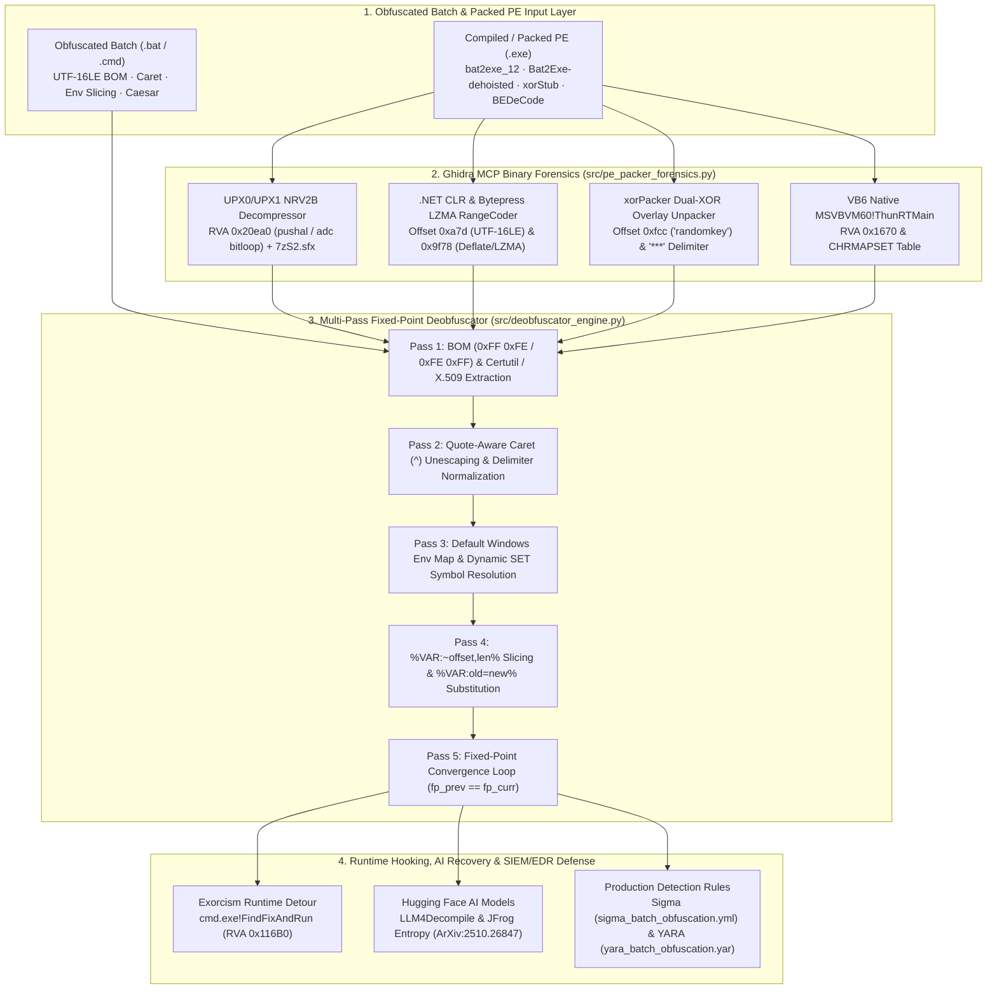

<div align="center">

<p align="center">
  <strong>🇺🇸 English</strong> · <a href="./docs/locales/ko.md">🇰🇷 한국어</a> · <a href="./docs/locales/zh-CN.md">🇨🇳 中文</a> · <a href="./docs/locales/es.md">🇪🇸 Español</a> · <a href="./docs/locales/hi.md">🇮🇳 हिन्दी</a><br />
  <a href="./docs/locales/ar.md">🇸🇦 العربية</a> · <a href="./docs/locales/pt-BR.md">🇧🇷 Português</a> · <a href="./docs/locales/ru.md">🇷🇺 Русский</a> · <a href="./docs/locales/fr.md">🇫🇷 Français</a> · <a href="./docs/locales/id.md">🇮🇩 Bahasa Indonesia</a>
</p>

<p align="center">
  <a href="https://github.com/maya-thorne/batch-deobfuscator-re"></a>
</p>

# 🔬 batch-deobfuscator-re

**Multi-Pass Batch Deobfuscator Engine, Ghidra PE Unpacker Forensics & Reference Archive**

[](./docs/whitepapers/GHIDRA_BINARY_RE_AND_DEOBFUSCATOR_ENGINE_ANALYSIS.md)
[](./src/deobfuscator_engine.py)
[](./src/pe_packer_forensics.py)
[](./rules/)
[](https://github.com/maya-thorne/batch-deobfuscator-re/releases)
[](./LICENSE)

<sub>Engineered &amp; Audited by **[Maya Thorne](https://github.com/maya-thorne)** · Low-Level Systems &amp; Reverse Engineering Research</sub>

</div>

---

## 🏛️ 1. Architecture & Reverse Engineering Pipeline

`batch-deobfuscator-re` combines **Ghidra MCP (`ghidra-re-operator`) binary reverse engineering** of Windows Batch-to-EXE compilers/packers, **line-by-line source code dissection of 7 flagship obfuscation/deobfuscation engines**, a **custom Python Multi-Pass Fixed-Point Static Deobfuscator (`src/deobfuscator_engine.py`)**, a **Static PE Packer Forensic Unpacker (`src/pe_packer_forensics.py`)**, and **48+ flattened open-source & Hugging Face AI references**.


<p align="center">
  <a href="https://github.com/maya-thorne/batch-deobfuscator-re"></a>
</p>



---

## 📚 2. Master Whitepapers & Core Documentation Index

<table width="100%">
  <thead>
    <tr>
      <th width="32%" align="left">📄 Document / Whitepaper</th>
      <th width="58%" align="left">🔬 Scope &amp; Technical Highlights</th>
      <th width="10%" align="center">📦 Size</th>
    </tr>
  </thead>
  <tbody>
    <tr>
      <td>
        🔬 <strong><a href="./docs/whitepapers/GHIDRA_BINARY_RE_AND_DEOBFUSCATOR_ENGINE_ANALYSIS.md">Binary RE &amp; Engine Analysis</a></strong><br>
        <code>GHIDRA_BINARY_RE_<wbr>AND_DEOBFUSCATOR_<wbr>ENGINE_ANALYSIS.md</code>
      </td>
      <td>
        <strong>Ghidra MCP 7-Binary Disassembly &amp; 7-Tool Source Dissection</strong>: <code>bat2exe_12.exe</code> (<code>0x20ea0</code> UPX NRV2B), <code>example_bytepressed.exe</code> (<code>0x9f78</code> LZMA RangeCoder), <code>xorStub.exe</code> (<code>0xfcc "randomkey"</code>), <code>BEDeCode.exe</code> (<code>0x1670</code> VB6 <code>ThunRTMain</code>), plus <code>Invoke-DOSfuscation</code>, <code>SomalifuscatorV2</code>, <code>BatCloak</code>, <code>Exorcism</code>, <code>0xidiz3r</code>, <code>Bat2Exe-dehoisted</code>, <code>batch_deobfuscator</code>.
      </td>
      <td align="center"><strong>43.7 KB</strong></td>
    </tr>
    <tr>
      <td>
        📖 <strong><a href="./docs/whitepapers/BATCH_OBFUSCATION_MASTER_GUIDE.md">30-Year Evolution &amp; Architecture</a></strong><br>
        <code>BATCH_OBFUSCATION_<wbr>MASTER_GUIDE.md</code>
      </td>
      <td>
        <strong>30-Year Evolution &amp; Architecture Guide</strong>: 1990s MS-DOS to 2026 AI, <code>cmd.exe</code> 5-stage parser state machine, 12 obfuscation techniques, 4-Tier 45-repo matrix, Sigma/YARA rules.
      </td>
      <td align="center"><strong>33.6 KB</strong></td>
    </tr>
    <tr>
      <td>
        🛡️ <strong><a href="./docs/whitepapers/BATCH_OBFUSCATION_ENCYCLOPEDIA.md">Master Encyclopedia (v2.0)</a></strong><br>
        <code>BATCH_OBFUSCATION_<wbr>ENCYCLOPEDIA.md</code>
      </td>
      <td>
        <strong>Comprehensive Encyclopedia (v2.0)</strong>: 48 repositories taxonomy, AST pushdown automata, Hugging Face dataset integration.
      </td>
      <td align="center"><strong>30.3 KB</strong></td>
    </tr>
    <tr>
      <td>
        🧬 <strong><a href="./docs/whitepapers/DEEP_REVERSE_ENGINEERING_AND_SOURCE_ANALYSIS.md">Deep Binary &amp; Source Analysis</a></strong><br>
        <code>DEEP_REVERSE_<wbr>ENGINEERING_<wbr>AND_SOURCE_ANALYSIS.md</code>
      </td>
      <td>
        <strong>Extended Binary &amp; Source Analysis</strong>: Supplemental PE header forensics, <code>choice.exe</code> MSVC SEH frame (<code>fs:[0]</code>), and runtime hook tables.
      </td>
      <td align="center"><strong>42.8 KB</strong></td>
    </tr>
    <tr>
      <td>
        🤗 <strong><a href="./docs/whitepapers/HUGGINGFACE_MODELS_AND_DATASETS.md">AI Models &amp; Datasets</a></strong><br>
        <code>HUGGINGFACE_MODELS_<wbr>AND_DATASETS.md</code>
      </td>
      <td>
        <strong>AI Deobfuscation &amp; Entropy Research</strong>: <code>LLM4Decompile-SFT-Deobfuscate</code>, <code>c-deobfuscate-mt</code> (T5), JFrog Token Entropy (ArXiv:2510.26847), EDR Telemetry.
      </td>
      <td align="center"><strong>Full Report</strong></td>
    </tr>
    <tr>
      <td>
        🕵️ <strong><a href="./docs/whitepapers/RESEARCH_WHITEPAPERS_AND_REPORTS.md">Threat Intelligence Reports</a></strong><br>
        <code>RESEARCH_WHITEPAPERS_<wbr>AND_REPORTS.md</code>
      </td>
      <td>
        <strong>Global Threat Intelligence Breakdown</strong>: Mandiant (Daniel Bohannon <code>DOSfuscation</code> / <code>FIN7</code>) &amp; Palo Alto Unit 42 (<code>BatCloak</code> / <code>ScrubCrypt</code>).
      </td>
      <td align="center"><strong>Full Report</strong></td>
    </tr>
    <tr>
      <td>
        📜 <strong><a href="./docs/whitepapers/CLASSIC_TO_MODERN_EVOLUTION.md">Classic to Modern Evolution</a></strong><br>
        <code>CLASSIC_TO_MODERN_<wbr>EVOLUTION.md</code>
      </td>
      <td>
        <strong>Historical Evolution &amp; PoC Analysis</strong>: Generation 1–5 batch obfuscation paradigms &amp; <code>BatCloak</code>/<code>ScrubCrypt</code> 3-stage loader forensics.
      </td>
      <td align="center"><strong>Full Report</strong></td>
    </tr>
  </tbody>
</table>

---

## 🔍 3. Ghidra MCP Binary Reverse Engineering Summary (7 PE Binaries)

<table width="100%">
  <thead>
    <tr>
      <th width="22%" align="left">🎯 Target Binary</th>
      <th width="18%" align="left">🏗️ Compiler / Packer</th>
      <th width="16%" align="center">📍 Entry RVA / Offset</th>
      <th width="44%" align="left">🔬 Disassembled Mechanism &amp; Forensic Finding</th>
    </tr>
  </thead>
  <tbody>
    <tr>
      <td>
        <strong><code>bat2exe_12.exe</code></strong><br>
        <small>(<code>bat2exe-islamadel</code>)</small>
      </td>
      <td>Native C++<br><sub>UPX NRV2B + <code>7zS2.sfx</code></sub></td>
      <td align="center"><code>0x20ea0</code><br><sub>(File <code>0xd2a0</code>)</sub></td>
      <td>
        <code>UPX0</code> (RVA <code>0x1000</code>, raw <code>0B</code>) + <code>UPX1</code> (RVA <code>0x14000</code>, raw <code>56,832B</code>). <code>pushal</code> saves registers, <code>lea edi, [esi-0x13000]</code> targets <code>UPX0</code>, and <code>add ebx, ebx</code> / <code>adc eax, eax</code> unpacks NRV2B bitstream; <code>bat2exe.cmd</code> merges <code>7zS2.sfx + config.txt + 7z</code> via <code>copy /b</code>.
      </td>
    </tr>
    <tr>
      <td>
        <strong><code>BEDeCode.exe</code></strong><br>
        <small>(<code>Batch-Encryption-DeCoder</code>)</small>
      </td>
      <td>VB6 Native Code<br><sub>(<code>MSVBVM60.DLL</code>)</sub></td>
      <td align="center"><code>0x1670</code><br><sub>(File <code>0x1670</code>)</sub></td>
      <td>
        <code>PUSH 0x401968 (VBHeader)</code> ➔ <code>CALL 0x0040166a (JMP [0x004010a0] ThunRTMain)</code>.<br>
        Contains <code>CHRMAPSET</code> substitution table at <code>0x32c8 (w54s8a7d6f9j3k2l...)</code> to invert <code>0xFF 0xFE 0x0D 0x0A cls</code> header cipher.
      </td>
    </tr>
    <tr>
      <td>
        <strong><code>example.exe</code></strong><br>
        <small>(<code>Bat2Exe-dehoisted</code>)</small>
      </td>
      <td>C# .NET CLR<br><sub>(<code>AnyCPU</code>)</sub></td>
      <td align="center"><code>0x2050</code><br><sub>(Offset <code>0xa7d</code>)</sub></td>
      <td>
        Uncompressed <code>.text</code> section exposes UTF-16LE batch script (<code>@echo off...</code>) in <code>.NET #US</code> (User Strings) heap at <code>0xa7d</code>, passed directly to <code>Process.Start("cmd.exe", "/c ...")</code>.
      </td>
    </tr>
    <tr>
      <td>
        <strong><code>example_encoded.exe</code></strong><br>
        <small>(<code>Bat2Exe-dehoisted</code>)</small>
      </td>
      <td>C# .NET CLR<br><sub>(Base64 Wrapper)</sub></td>
      <td align="center">Offset <code>0xa7d</code><br><sub>(<code>#US</code> Heap)</sub></td>
      <td>
        Wraps batch payload in <code>Convert.FromBase64String(...)</code> inside <code>CMethods.ExecuteCommand</code>, still statically recoverable from <code>#US</code> stream.
      </td>
    </tr>
    <tr>
      <td>
        <strong><code>example_bytepressed.exe</code></strong><br>
        <small>(<code>Bat2Exe-dehoisted</code>)</small>
      </td>
      <td>C# .NET CLR<br><sub>(Bytepress LZMA)</sub></td>
      <td align="center">Offset <code>0x9f78</code><br><sub>(<code>RangeCoder</code>)</sub></td>
      <td>
        Embeds <code>bytepress.lib.LZMA.Compress.RangeCoder</code> (<code>BitTreeEncoder</code>, <code>LzBinTree</code>) and decompresses resource stream in-memory into <code>Assembly.Load(byte[])</code>.
      </td>
    </tr>
    <tr>
      <td>
        <strong><code>xorStub.exe</code></strong><br>
        <small>(<code>xorPacker-master</code>)</small>
      </td>
      <td>MSVC Native C++<br><sub>(PE Overlay)</sub></td>
      <td align="center"><code>0x2dcc</code><br><sub>(File <code>0xfcc</code>)</sub></td>
      <td>
        Hardcodes 9-byte master key <code>"randomkey"</code> at <code>0xfcc</code>. Splits EOF overlay by <code>"***" (0x2A 0x2A 0x2A)</code>, decrypts dynamic key via <code>XOR(part[2], "randomkey")</code>, then decrypts payload via <code>XOR(part[1], dyn_key)</code> into <code>%TEMP%\temp.exe</code>.
      </td>
    </tr>
    <tr>
      <td>
        <strong><code>choice.exe</code></strong><br>
        <small>(<code>bat2exe-islamadel</code>)</small>
      </td>
      <td>MSVC Native C<br><sub>(<code>MSVCRT.dll</code>)</sub></td>
      <td align="center"><code>0x1491</code><br><sub>(CRT Startup)</sub></td>
      <td>
        Sets up x86 SEH frame (<code>mov eax, fs:[0]</code>, <code>push 0x4015c0 __except_handler3</code>), parses single-keystroke timeout for legacy batch menus.
      </td>
    </tr>
  </tbody>
</table>

---

## 🛠️ 4. Quickstart: CLI Toolchain & Deobfuscator Engine

<p align="center">
  <a href="https://github.com/maya-thorne/batch-deobfuscator-re"></a>
</p>

### 4.1 Production CLI Usage (`batch-deobfuscator` / `python -m deobfuscator`)
```bash
# 1. Install locally via PEP 517/621
pip install .

# 2. One-click deobfuscation to stdout or clean output file
batch-deobfuscator samples/01_env_slicing_sample.bat
batch-deobfuscator samples/02_caret_and_delimiters_sample.bat -o clean.bat

# 3. View terminal colorized Before & After syntax diff
batch-deobfuscator samples/02_caret_and_delimiters_sample.bat --diff

# 4. Export forensic telemetry & resolved symbol table in JSON format
batch-deobfuscator samples/03_dynamic_substitution_table_sample.bat --format json

# 5. Direct Python module execution (zero installation required)
python -m deobfuscator samples/01_env_slicing_sample.bat --verbose
```

### 4.2 CLI Options & Flags Reference
| Flag | Description | Default |
| :--- | :--- | :---: |
| `<input>` | Obfuscated `.bat` or `.cmd` file path | *Required* |
| `-o, --output` | Destination path for cleaned output script | `stdout` |
| `-p, --passes` | Maximum fixed-point normalization passes | `15` |
| `-d, --diff` | Render unified color diff highlighting transformed lines | `False` |
| `--format` | Output format: `text` or `json` (with forensic telemetry) | `text` |
| `-v, --verbose` | Stream pass convergence telemetry and symbol counts | `False` |
| `--version` | Display version and author information | `1.0.0` |

### 4.3 Static PE Packer Forensic Analyzer (`src/pe_packer_forensics.py`)
```bash
python src/pe_packer_forensics.py references/github_arsenal/bat2exe-islamadel/bat2exe_12.exe
```

### 4.4 Automated Verification Test Suites
```bash
python tests/test_cli.py     # 6 CLI flags, diff mode, and JSON telemetry tests
python tests/test_suite.py   # 4 core AST deobfuscation & PE overlay tests
```

---


## 📂 5. Repository Directory Structure

```text
batch-deobfuscator-re/
├── pyproject.toml                         # 📦 PEP 517/621 Standard Package Configuration
├── README.md                              # 📖 Master Documentation & Architecture Hub
├── LICENSE                                # 📜 Maya Thorne Systems & Security Research License (MT-SRL)
│
├── deobfuscator/                          # 🛠️ Production CLI Toolchain Package (python -m deobfuscator)
│   ├── __init__.py                        # Version 1.0.0 & Public API exports
│   ├── __main__.py                        # Module CLI execution entrypoint
│   ├── cli.py                             # Rich CLI Interface (argparse, JSON, Diff, Colors)
│   ├── core.py                            # Multi-Pass Fixed-Point Convergence Engine
│   ├── normalizers.py                     # Modular Caret, BOM, Quote, Env Normalizers
│   └── diff.py                            # Terminal Color Unified Diff Generator
│
├── docs/                                  # 🌐 Documentation Hub (Slim Root Architecture)
│   ├── whitepapers/                       # 🔬 9 Flagship Technical & Forensic Analysis Papers
│   ├── locales/                           # 🌍 10-Language Localized Documentation Hub
│   └── assets/                            # 🎨 Localized SVGs & Terminal Animation Demo
│
├── src/                                   # ⚙️ Standalone Core Forensic Engines
│   ├── deobfuscator_engine.py             # Multi-Pass Static Normalizer Engine
│   └── pe_packer_forensics.py             # Ghidra-Derived Static PE Unpacker
│
├── tests/                                 # ✅ Automated Test Suites (10 Tests Total)
│   ├── test_cli.py                        # 6 CLI flags, JSON, and diff tests
│   └── test_suite.py                      # 4 AST convergence & PE unpacking tests
│
├── rules/                                 # 🛡️ Production SIEM / EDR Detection Rules
│   ├── sigma_batch_obfuscation.yml        # Sigma Rules for Carets, Slicing, Exorcism
│   └── yara_batch_obfuscation.yar         # YARA Rules for BOMs, Somalifuscator, UPX
│
├── samples/                               # 🧪 6 Classic & Modern Obfuscated Samples
└── references/                            # 📦 48+ Flattened Open-Source & AI Mirrors
    ├── github_arsenal/                    # 28+ Deconstructed Open-Source Projects
    └── huggingface_ai/                    # Hugging Face AI Models & Datasets
```

---

---

## 📜 6. License & Open-Source Research Credits

This project is licensed under the [MIT License](./LICENSE). Copyright © 2026 Maya Thorne.

### 🌟 Open-Source References & Research Citations
This archive and forensic deobfuscator engine study, catalog, and build upon pioneering reverse engineering and security research:

| Project / Research | Author / Organization | Focus & Attribution |
| :--- | :--- | :--- |
| **`Invoke-DOSfuscation`** | Daniel Bohannon (Mandiant) | Groundbreaking research on cmd.exe obfuscation techniques and detection |
| **`BatCloak & ScrubCrypt`** | Palo Alto Networks Unit 42 | In-depth threat research on modern multi-stage batch malware loaders |
| **`assemblyline-batchdeobfuscator`** | Canadian Centre for Cyber Security (CCCS) | Production-grade batch deobfuscation service and heuristic extraction |
| **`batch-deobfuscator`** | DissectMalware / d4rksystem | Static batch deobfuscation engine and caret normalization |
| **`SomalifuscatorV2`** | KDot227 | High-entropy variable substitution & multi-pass batch protection |
| **`Exorcism`** | 0x00101 / Community | Runtime detour hooking on `cmd.exe!FindFixAndRun` (RVA `0x116b0`) |
| **`0xidiz3r`** | KDot227 / Community | Dynamic table slicing and environment variable reconstruction |
| **`Bat2Exe-dehoisted`** | Dehoisted | .NET CLR batch compilation and Bytepress LZMA RangeCoder packing |
| **`bat2exe-islamadel`** | Islam Adel | Native C++ UPX-packed 7-Zip SFX batch wrapper architecture |
| **`xorPacker`** | Red-Team / Community | Dynamic 2-stage XOR overlay packer with hardcoded master keys |
| **`BEDeCode`** | vb6-coder / Community | Legacy Visual Basic 6.0 `CHRMAPSET` batch decompiler |
| **`LLM4Decompile`** | Alvr / Hugging Face | Deep learning decompilation & code representation benchmarks |
| **`JFrog Batch Entropy`** | JFrog Security Research | Token entropy estimation and batch anomaly scoring (ArXiv:2510.26847) |
