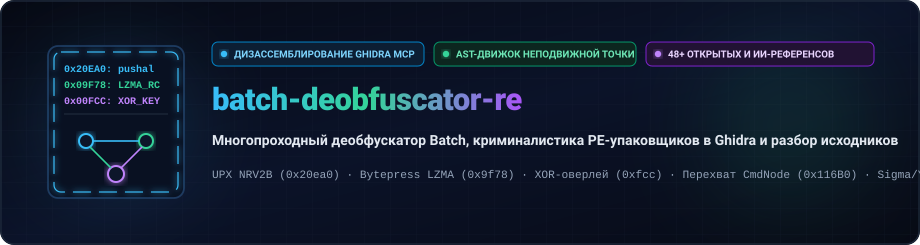
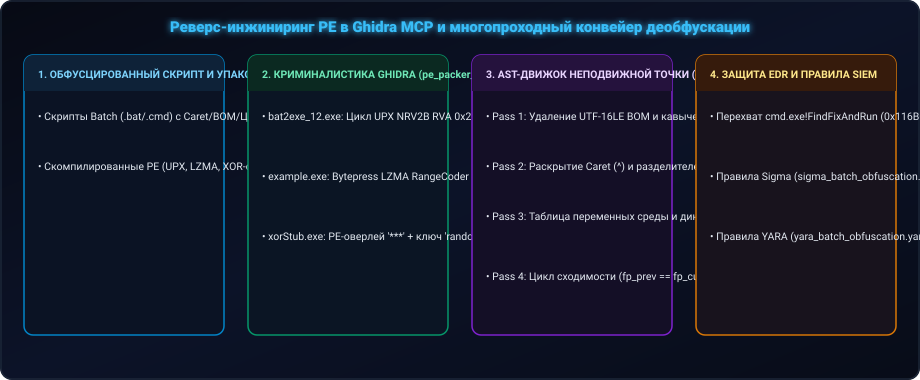
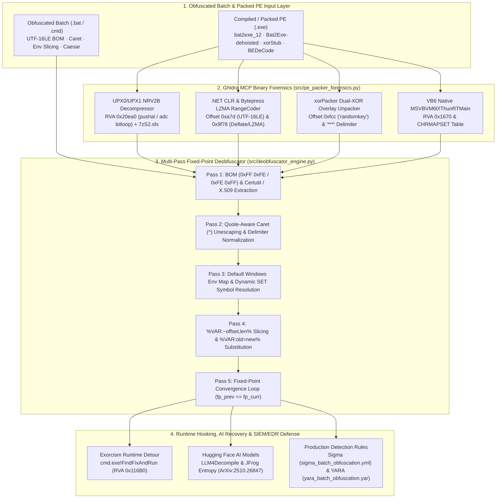

<div align="center">

<p align="center">
  <a href="../../README.md">🇺🇸 English</a> · <a href="./ko.md">🇰🇷 한국어</a> · <a href="./zh-CN.md">🇨🇳 中文</a> · <a href="./es.md">🇪🇸 Español</a> · <a href="./hi.md">🇮🇳 हिन्दी</a><br />
  <a href="./ar.md">🇸🇦 العربية</a> · <a href="./pt-BR.md">🇧🇷 Português</a> · <strong>🇷🇺 Русский</strong> · <a href="./fr.md">🇫🇷 Français</a> · <a href="./id.md">🇮🇩 Bahasa Indonesia</a>
</p>

<p align="center">
  <a href="https://github.com/maya-thorne/batch-deobfuscator-re"></a>
</p>

# 🔬 batch-deobfuscator-re

**Многопроходный деобфускатор Batch, криминалистика PE-упаковщиков в Ghidra и разбор исходников**

[](../../GHIDRA_BINARY_RE_AND_DEOBFUSCATOR_ENGINE_ANALYSIS.md)
[](../../src/deobfuscator_engine.py)
[](../../src/pe_packer_forensics.py)
[](../../rules/)
[](https://github.com/maya-thorne/batch-deobfuscator-re/releases)
[](../../LICENSE)

<sub>Engineered &amp; Audited by **[Maya Thorne](https://github.com/maya-thorne)** · Low-Level Systems &amp; Reverse Engineering Research</sub>

</div>

---

## 🏛️ 1. Architecture & Reverse Engineering Pipeline

`batch-deobfuscator-re` combines **Ghidra MCP (`ghidra-re-operator`) binary reverse engineering** of Windows Batch-to-EXE compilers/packers, **line-by-line source code dissection of 7 flagship obfuscation/deobfuscation engines**, a **custom Python Multi-Pass Fixed-Point Static Deobfuscator (`src/deobfuscator_engine.py`)**, a **Static PE Packer Forensic Unpacker (`src/pe_packer_forensics.py`)**, and **48+ flattened open-source & Hugging Face AI references**.


<p align="center">
  <a href="https://github.com/maya-thorne/batch-deobfuscator-re"></a>
</p>



---

## 📚 2. Master Whitepapers & Core Documentation Index

| Document | Scope & Technical Highlights | Size |
| :--- | :--- | :---: |
| 🔬 **[`GHIDRA_BINARY_RE_AND_DEOBFUSCATOR_ENGINE_ANALYSIS.md`](../../GHIDRA_BINARY_RE_AND_DEOBFUSCATOR_ENGINE_ANALYSIS.md)** | **Ghidra MCP 7-Binary Disassembly & 7-Tool Source Code Dissection**: `bat2exe_12.exe` (`0x20ea0` UPX NRV2B), `example_bytepressed.exe` (`0x9f78` LZMA RangeCoder), `xorStub.exe` (`0xfcc` `"randomkey"`), `BEDeCode.exe` (`0x1670` VB6 `ThunRTMain`), plus `Invoke-DOSfuscation`, `SomalifuscatorV2`, `BatCloak`, `Exorcism`, `0xidiz3r`, `Bat2Exe-dehoisted`, `batch_deobfuscator` | **43.7 KB** |
| 📖 **[`BATCH_OBFUSCATION_MASTER_GUIDE.md`](../../BATCH_OBFUSCATION_MASTER_GUIDE.md)** | **30-Year Evolution & Architecture Guide**: 1990s MS-DOS to 2026 AI, `cmd.exe` 5-stage parser state machine, 12 obfuscation techniques, 4-Tier 45-repo matrix, Sigma/YARA rules | **33.6 KB** |
| 🛡️ **[`BATCH_OBFUSCATION_ENCYCLOPEDIA.md`](../../BATCH_OBFUSCATION_ENCYCLOPEDIA.md)** | **Comprehensive Encyclopedia (v2.0)**: 48 repositories taxonomy, AST pushdown automata, Hugging Face dataset integration | **30.3 KB** |
| 🧬 **[`DEEP_REVERSE_ENGINEERING_AND_SOURCE_ANALYSIS.md`](../../DEEP_REVERSE_ENGINEERING_AND_SOURCE_ANALYSIS.md)** | **Extended Binary & Source Analysis**: Supplemental PE header forensics, `choice.exe` MSVC SEH frame (`fs:[0]`), and runtime hook tables | **42.8 KB** |
| 🤗 **[`docs/HUGGINGFACE_MODELS_AND_DATASETS.md`](../../docs/HUGGINGFACE_MODELS_AND_DATASETS.md)** | **AI Deobfuscation & Entropy Research**: `LLM4Decompile-SFT-Deobfuscate`, `c-deobfuscate-mt` (T5), JFrog Token Entropy (ArXiv:2510.26847), EDR Telemetry | **Full Report** |
| 🕵️ **[`docs/RESEARCH_WHITEPAPERS_AND_REPORTS.md`](../../docs/RESEARCH_WHITEPAPERS_AND_REPORTS.md)** | **Global Threat Intelligence Breakdown**: Mandiant (Daniel Bohannon `DOSfuscation` / `FIN7`) & Palo Alto Unit 42 (`BatCloak` / `ScrubCrypt`) | **Full Report** |
| 📜 **[`docs/CLASSIC_TO_MODERN_EVOLUTION.md`](../../docs/CLASSIC_TO_MODERN_EVOLUTION.md)** | **Historical Evolution & PoC Analysis**: Generation 1–5 batch obfuscation paradigms & `BatCloak`/`ScrubCrypt` 3-stage loader forensics | **Full Report** |

---

## 🔍 3. Ghidra MCP Binary Reverse Engineering Summary (7 PE Binaries)

| Target Binary | Compiler / Packer | Entry RVA / Key Offset | Disassembled Mechanism & Forensic Finding |
| :--- | :--- | :---: | :--- |
| **`bat2exe_12.exe`** (`bat2exe-islamadel`) | Native C++ + **UPX NRV2B** + `7zS2.sfx` | `RVA 0x20ea0` (File `0xd2a0`) | `UPX0` (RVA `0x1000`, raw `0B`) + `UPX1` (RVA `0x14000`, raw `56,832B`). `pushal` saves registers, `lea edi, [esi-0x13000]` targets `UPX0`, and `add ebx, ebx` / `adc eax, eax` unpacks NRV2B bitstream; `bat2exe.cmd` merges `7zS2.sfx + config.txt + 7z` via `copy /b`. |
| **`BEDeCode.exe`** (`Batch-Encryption-DeCoder`) | **VB6 Native Code** (`MSVBVM60.DLL`) | `RVA 0x1670` (File `0x1670`) | `PUSH 0x401968` (`VBHeader`) -> `CALL 0x0040166a` (`JMP [0x004010a0]` `ThunRTMain`). Contains `CHRMAPSET` substitution table at `0x32c8` (`w54s8a7d6f9j3k2l...`) to invert `0xFF 0xFE 0x0D 0x0A cls` header cipher. |
| **`example.exe`** (`Bat2Exe-dehoisted`) | **C# .NET CLR** (`AnyCPU`) | `RVA 0x2050` / Offset `0xa7d` | Uncompressed `.text` section exposes UTF-16LE batch script (`@echo off...`) in `.NET` `#US` (User Strings) heap at `0xa7d`, passed directly to `Process.Start("cmd.exe", "/c ...")`. |
| **`example_encoded.exe`** (`Bat2Exe-dehoisted`) | **C# .NET CLR** + Base64 Wrapper | Offset `0xa7d` (`#US` Heap) | Wraps batch payload in `Convert.FromBase64String(...)` inside `CMethods.ExecuteCommand`, still statically recoverable from `#US` stream. |
| **`example_bytepressed.exe`** (`Bat2Exe-dehoisted`) | **C# .NET CLR** + **Bytepress LZMA** | Offset `0x9f78` (`RangeCoder`) | Embeds `bytepress.lib.LZMA.Compress.RangeCoder` (`BitTreeEncoder`, `LzBinTree`) and decompresses resource stream in-memory into `Assembly.Load(byte[])`. |
| **`xorStub.exe`** (`xorPacker-master`) | **MSVC Native C++** (`PE Overlay`) | `RVA 0x2dcc` (File `0xfcc`) | Hardcodes 9-byte master key `"randomkey"` at `0xfcc`. Splits EOF overlay by `"***"` (`0x2A 0x2A 0x2A`), decrypts dynamic key via `XOR(part[2], "randomkey")`, then decrypts payload via `XOR(part[1], dyn_key)` into `%TEMP%\temp.exe`. |
| **`choice.exe`** (`bat2exe-islamadel`) | **MSVC Native C** (`MSVCRT.dll`) | `RVA 0x1491` (CRT Startup) | Sets up x86 SEH frame (`mov eax, fs:[0]`, `push 0x4015c0 __except_handler3`), parses single-keystroke timeout for legacy batch menus. |

---

## 🛠️ 4. Quickstart: CLI Toolchain & Deobfuscator Engine

<p align="center">
  <a href="https://github.com/maya-thorne/batch-deobfuscator-re"></a>
</p>

### 4.1 Production CLI Usage (`batch-deobfuscator` / `python -m deobfuscator`)
```bash
# 1. Install locally via PEP 517/621
pip install .

# 2. One-click deobfuscation to stdout or clean output file
batch-deobfuscator samples/01_env_slicing_sample.bat
batch-deobfuscator samples/02_caret_and_delimiters_sample.bat -o clean.bat

# 3. View terminal colorized Before & After syntax diff
batch-deobfuscator samples/02_caret_and_delimiters_sample.bat --diff

# 4. Export forensic telemetry & resolved symbol table in JSON format
batch-deobfuscator samples/03_dynamic_substitution_table_sample.bat --format json

# 5. Direct Python module execution (zero installation required)
python -m deobfuscator samples/01_env_slicing_sample.bat --verbose
```

### 4.2 CLI Options & Flags Reference
| Flag | Description | Default |
| :--- | :--- | :---: |
| `<input>` | Obfuscated `.bat` or `.cmd` file path | *Required* |
| `-o, --output` | Destination path for cleaned output script | `stdout` |
| `-p, --passes` | Maximum fixed-point normalization passes | `15` |
| `-d, --diff` | Render unified color diff highlighting transformed lines | `False` |
| `--format` | Output format: `text` or `json` (with forensic telemetry) | `text` |
| `-v, --verbose` | Stream pass convergence telemetry and symbol counts | `False` |
| `--version` | Display version and author information | `1.0.0` |

### 4.3 Static PE Packer Forensic Analyzer (`src/pe_packer_forensics.py`)
```bash
python src/pe_packer_forensics.py references/01_github_arsenal/bat2exe-islamadel/bat2exe_12.exe
```

### 4.4 Automated Verification Test Suites
```bash
python tests/test_cli.py     # 6 CLI flags, diff mode, and JSON telemetry tests
python tests/test_suite.py   # 4 core AST deobfuscation & PE overlay tests
```

---


## 📂 5. Repository Directory Structure

```text
batch-deobfuscator-re/
├── pyproject.toml                         # 📦 PEP 517/621 Standard Package Configuration
├── README.md                              # 📖 Master Documentation & Architecture Hub
├── LICENSE                                # 📜 MIT License
│
├── deobfuscator/                          # 🛠️ Production CLI Toolchain Package
│   ├── __init__.py                        # Version 1.0.0 & Public API exports
│   ├── __main__.py                        # python -m deobfuscator entrypoint
│   ├── cli.py                             # Rich CLI (argparse, JSON, Diff, Colors)
│   ├── core.py                            # Multi-Pass Fixed-Point Convergence Engine
│   ├── normalizers.py                     # Modular Caret, BOM, Quote, Env Normalizers
│   └── diff.py                            # Terminal Color Unified Diff Generator
│
├── src/                                   # ⚙️ Legacy & Standalone Forensic Engines
│   ├── deobfuscator_engine.py             # Standalone Batch Deobfuscator
│   └── pe_packer_forensics.py             # Ghidra-Derived Static PE Unpacker
│
├── tests/                                 # ✅ Automated Test Suites (10 Tests Total)
│   ├── test_cli.py                        # 6 CLI flags, JSON, and diff tests
│   └── test_suite.py                      # 4 AST convergence & PE unpacking tests
│
├── rules/                                 # 🛡️ Production SIEM / EDR Detection Rules
│   ├── sigma_batch_obfuscation.yml
│   └── yara_batch_obfuscation.yar
│
├── samples/                               # 🧪 6 Classic & Modern Obfuscated Samples
├── docs/                                  # 🌐 10-Language Locales, SVG Banners & Assets
│   ├── assets/demo_terminal.svg           # Animated Terminal Vector Demo
│   ├── assets/locales/<lang>/*.svg        # Localized Banners & Architecture Diagrams
│   └── locales/<lang>.md                  # 10 Localized Guides
│
└── references/                            # 📦 48+ Flattened Open-Source & AI Mirrors
```

---

---

## 📜 6. License & Open-Source Research Credits

This project is licensed under the [MIT License](../../LICENSE). Copyright © 2026 Maya Thorne.

### 🌟 Open-Source References & Research Citations
This archive and forensic deobfuscator engine study, catalog, and build upon pioneering reverse engineering and security research:

| Project / Research | Author / Organization | Focus & Attribution |
| :--- | :--- | :--- |
| **`Invoke-DOSfuscation`** | Daniel Bohannon (Mandiant) | Groundbreaking research on cmd.exe obfuscation techniques and detection |
| **`BatCloak & ScrubCrypt`** | Palo Alto Networks Unit 42 | In-depth threat research on modern multi-stage batch malware loaders |
| **`assemblyline-batchdeobfuscator`** | Canadian Centre for Cyber Security (CCCS) | Production-grade batch deobfuscation service and heuristic extraction |
| **`batch-deobfuscator`** | DissectMalware / d4rksystem | Static batch deobfuscation engine and caret normalization |
| **`SomalifuscatorV2`** | KDot227 | High-entropy variable substitution & multi-pass batch protection |
| **`Exorcism`** | 0x00101 / Community | Runtime detour hooking on `cmd.exe!FindFixAndRun` (RVA `0x116b0`) |
| **`0xidiz3r`** | KDot227 / Community | Dynamic table slicing and environment variable reconstruction |
| **`Bat2Exe-dehoisted`** | Dehoisted | .NET CLR batch compilation and Bytepress LZMA RangeCoder packing |
| **`bat2exe-islamadel`** | Islam Adel | Native C++ UPX-packed 7-Zip SFX batch wrapper architecture |
| **`xorPacker`** | Red-Team / Community | Dynamic 2-stage XOR overlay packer with hardcoded master keys |
| **`BEDeCode`** | vb6-coder / Community | Legacy Visual Basic 6.0 `CHRMAPSET` batch decompiler |
| **`LLM4Decompile`** | Alvr / Hugging Face | Deep learning decompilation & code representation benchmarks |
| **`JFrog Batch Entropy`** | JFrog Security Research | Token entropy estimation and batch anomaly scoring (ArXiv:2510.26847) |
